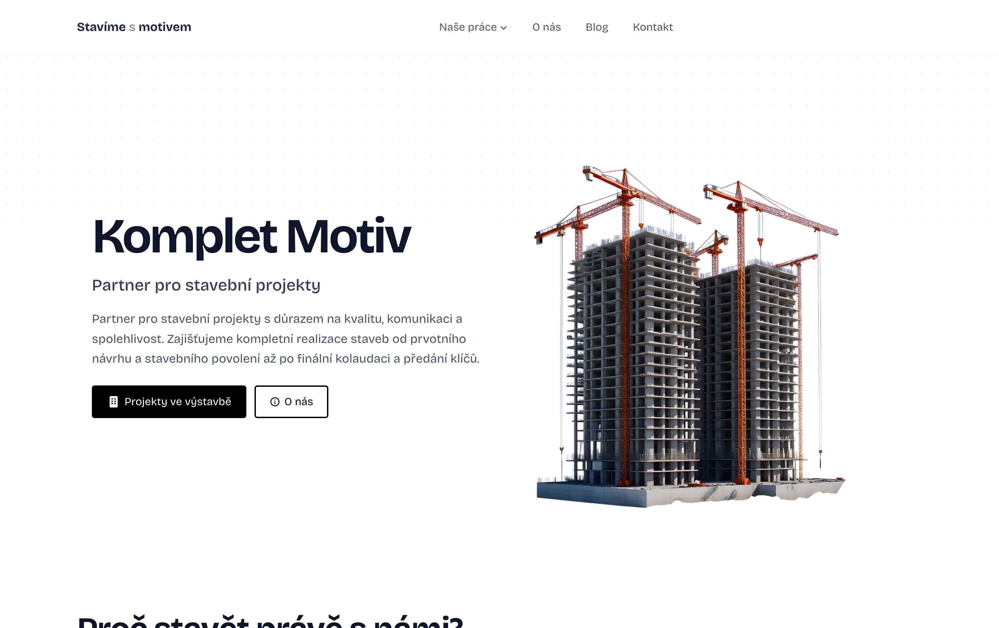
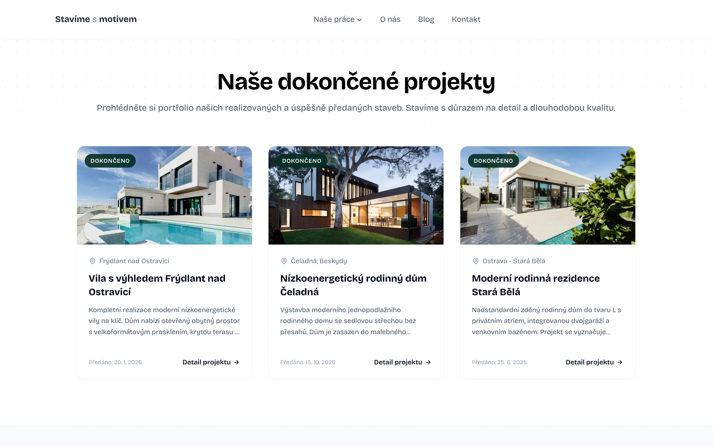
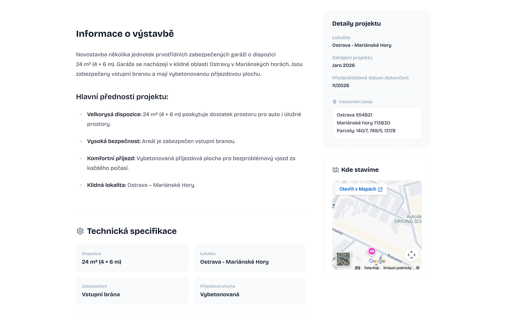
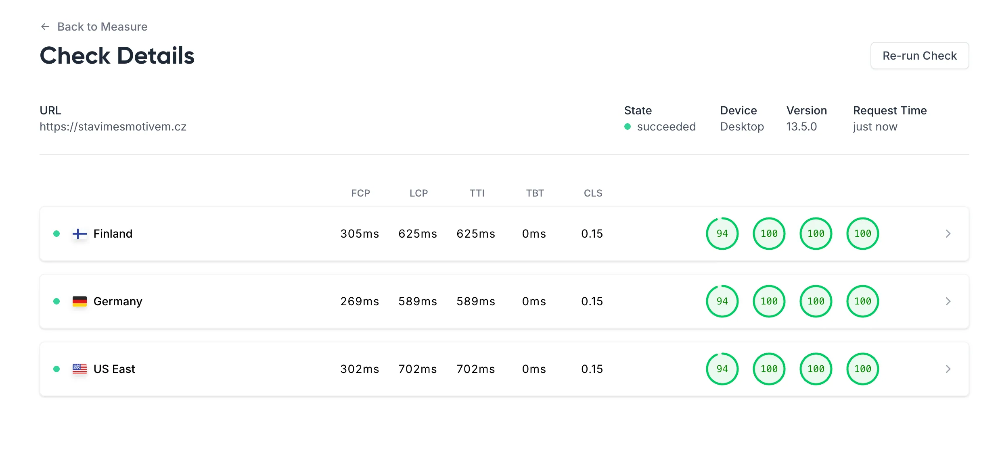

# stavimesmotivem.cz (Komplet Motiv) — Architectural Case Study

> **Notice on Proprietary Code & NDA Compliance:**  
> This website was designed and built as a commercial deliverable for a paying client.  
> To protect client intellectual property, copyrighted assets, and proprietary brand designs,  
> the production source repository remains private. This repository serves as an architectural  
> breakdown, responsive UI review, and web performance case study.

[🔗 Visit Live Website](https://stavimesmotivem.cz) · [📐 System Architecture](architecture.md) · [👤 Return to Portfolio](https://sehnalik.com)

---

  

---

## Overview & Scope

| Attribute | Specification |
| :--- | :--- |
| **Site Type** | Corporate Marketing Site & Construction Portfolio Platform |
| **Status** | Live in Production |
| **Runtime Topology** | Edge-First SSR + Embedded CMS (Cloudflare Workers Runtime) |
| **Frontend Stack** | Astro v5 / Tailwind CSS v4 / Vanilla TypeScript |
| **Data & Storage** | Cloudflare D1 (SQLite) / Cloudflare R2 Bucket / Local SQLite Fallback |
| **CMS & Mail Engine** | Embedded Schema-Driven CMS / Resend Transactional Mail API |
| **Architecture Specification** | Fully unified master document in [`architecture.md`](architecture.md) |

---

## Visual Showcase & Interface Gallery

Komplet Motiv delivers high-performance digital marketing, structured reference showcases, and lead generation for a regional construction and engineering company.

### Desktop Experience

  
  <em>Reference Portfolio & Projects (/projekty) — Structured residential and commercial development showcase with high-res photography.</em>

  
  <em>Contact & Direct Inquiries (/kontakt) — Accessible lead capture with native constraint validation and auto-responding email workflows.</em>

### Mobile-First Responsive Engineering

Pre-rendered layouts, fluid typography, and zero client hydration runtime guarantee instantaneous touch response and layout stability across all mobile viewports.

| Mobile Hero & Navigation | Mobile Project Details & Timeline |
| :---: | :---: |
|  |  |

---

## Core Web Vitals & Real Performance Audits

  

### Performance Engineering Takeaways
- **High Overall Category Scores:** 94 Performance, 100 Accessibility, 100 Best Practices, and 100 SEO across all global edge locations.
- **Zero Blocking Time (TBT = 0ms):** Public routes are compiled ahead-of-time into clean static HTML with zero client framework hydration, resulting in 0ms Total Blocking Time across all tested locations.
- **Fast Global Content Delivery (LCP < 710ms):** Cloudflare Pages Anycast edge routing ensures First Contentful Paint under 310ms and Largest Contentful Paint under 705ms, even on transatlantic requests.
- **Layout Stability:** Reserved aspect-ratio wrappers across media galleries and portfolio cards ensure layout consistency during asset loading.

For full benchmark analysis and technical drivers, see [`architecture.md § 10`](architecture.md#10-frontend-performance--core-web-vitals).

---

## Key Engineering Highlights

- **Unified Master Architecture ([`architecture.md`](architecture.md)):** An exhaustive specification covering Cloudflare Workers edge execution, D1 SQLite schema migrations, and transactional email triggers.
- **Single-Deployable Monolith:** Public marketing pages and the schema-driven CMS live in the same repository and deploy as a single Cloudflare Worker, eliminating external API latency.
- **Zero-Framework Runtime Baseline:** Public marketing and project pages ship as static HTML with zero JavaScript framework runtime, eliminating client hydration delays and preserving the main thread for immediate user input.
- **Native Constraint Validation:** Forms use the browser's native HTML5 validation APIs and CSS pseudo-classes (`:invalid`, `:placeholder-shown`) with accessible focus management.
- **Dynamic Construction Milestones:** Visual timeline calculating project phases (`isCompleted`, `isCurrent`, upcoming) without layout shifts.
- **Inlined Critical Styling:** Key layout CSS is inlined into the document `<head>`, avoiding render-blocking stylesheet network round trips.

---

## Showcase Components & Sanitized Patterns

To demonstrate real engineering approaches used in the production application without exposing proprietary business rules or credentials, the following sanitized components are available:

- 📄 [`components/SanitizedContactForm.astro`](components/SanitizedContactForm.astro) — Native HTML5 constraint validation form with accessible error focus management and asynchronous submission.
- 🏗️ [`components/SanitizedTimeline.astro`](components/SanitizedTimeline.astro) — Multi-stage construction timeline with responsive status badges and layout-shift prevention.
- ⚡ [`examples/sanitized-ui-pattern.ts`](examples/sanitized-ui-pattern.ts) — Clean TypeScript module demonstrating programmatic constraint validation and resilient asynchronous dispatch.

---

## Inquiries & Author

Designed & developed by **Robin Sehnalík**.  
For frontend contract availability or portfolio inquiries: [https://sehnalik.com](https://sehnalik.com).
