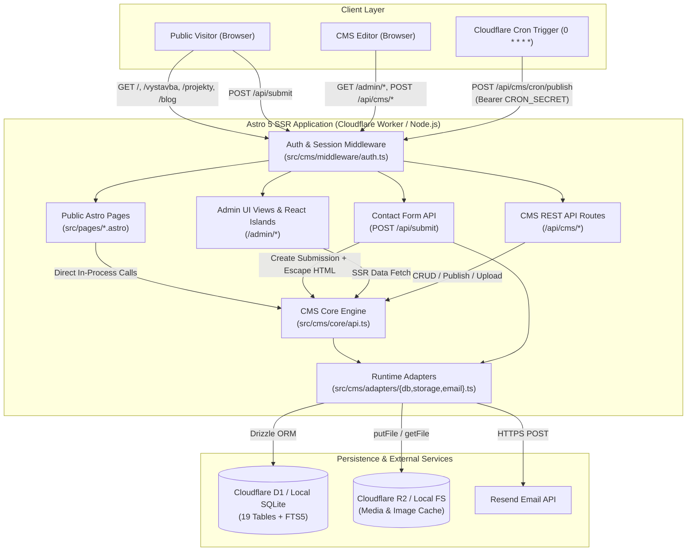
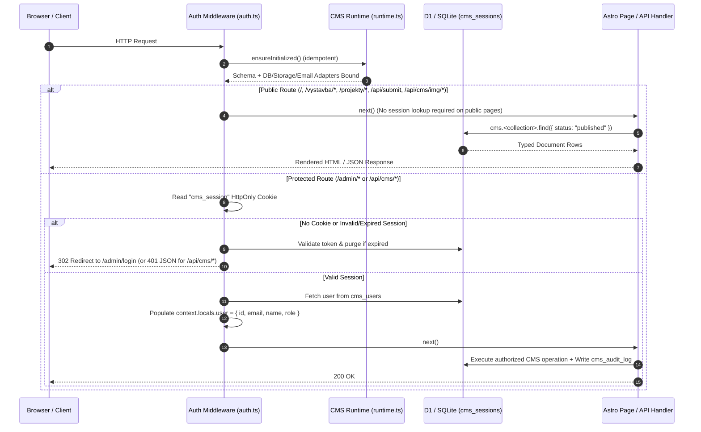
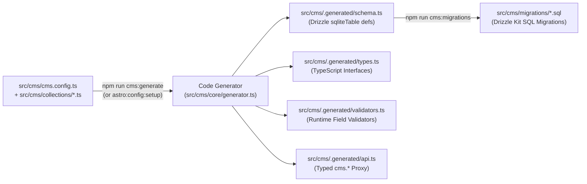
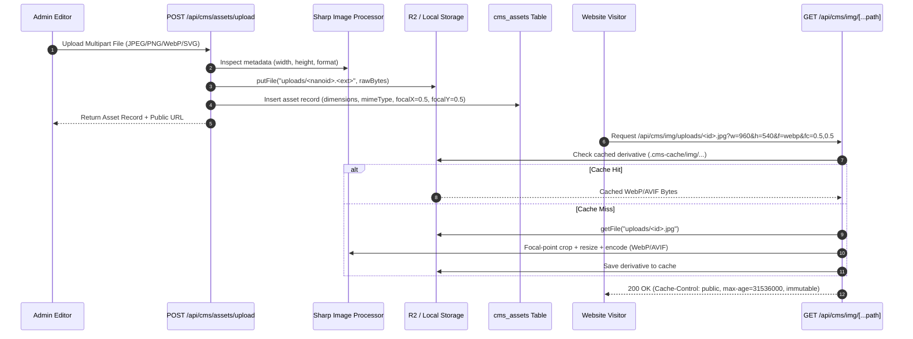

# System Architecture — Komplet Motiv (`stavimesmotivem.cz`)

> **What this repository does:**  
> **Komplet Motiv** (`stavimesmotivem.cz`) is the web platform and integrated headless/monolithic Content Management System (CMS) for **Komplet Motiv s.r.o.**, a Czech construction and real-estate development company. It serves public marketing pages, active construction listings (`výstavba`), completed reference projects (`projekty`), a photo gallery, a blog, and lead-capture forms—all powered by an embedded, schema-driven CMS running on **Astro 5 SSR**, **Cloudflare Workers (D1 + R2)** in production, and **Node.js (SQLite + local filesystem)** in local development.

---

## Table of Contents

1. [Core Stack & Target Scale](#1-core-stack--target-scale)
2. [Architectural Principles](#2-architectural-principles)
3. [System Diagrams](#3-system-diagrams)
   - [3.1 High-Level System Topology](#31-high-level-system-topology)
   - [3.2 Request Lifecycle & Auth Middleware](#32-request-lifecycle--auth-middleware)
   - [3.3 Schema-First Codegen Pipeline](#33-schema-first-codegen-pipeline)
   - [3.4 Asset Upload & Image Optimization Pipeline](#34-asset-upload--image-optimization-pipeline)
4. [Complete Repository File Map](#4-complete-repository-file-map)
5. [CMS Engine Architecture](#5-cms-engine-architecture)
   - [5.1 Declarative Config & Codegen](#51-declarative-config--codegen)
   - [5.2 Dual-Environment Runtime Adapters](#52-dual-environment-runtime-adapters)
   - [5.3 Document Lifecycle, Drafts & Locking](#53-document-lifecycle-drafts--locking)
   - [5.4 Full-Text Search (FTS5)](#54-full-text-search-fts5)
6. [Database Schema](#6-database-schema)
   - [6.1 Entity-Relationship Diagram](#61-entity-relationship-diagram)
   - [6.2 Content Collections (Multi-Document)](#62-content-collections-multi-document)
   - [6.3 Singleton Collections (Page & Site Config)](#63-singleton-collections-page--site-config)
   - [6.4 System & Infrastructure Tables](#64-system--infrastructure-tables)
7. [Styling, Typography & Design System](#7-styling-typography--design-system)
   - [7.1 Public Website Styling (`src/styles/global.css`)](#71-public-website-styling-srcstylesglobalcss)
   - [7.2 CMS Admin Design System (`src/styles/admin.css`)](#72-cms-admin-design-system-srcstylesadmincss)
   - [7.3 UI Component Architecture](#73-ui-component-architecture)
8. [Security & Access Control](#8-security--access-control)
9. [CLI Workflows, Testing & Deployment](#9-cli-workflows-testing--deployment)
10. [Frontend Performance & Core Web Vitals](#10-frontend-performance--core-web-vitals)
11. [Showcase Components & Sanitized Patterns](#11-showcase-components--sanitized-patterns)

---

## 1. Core Stack & Target Scale

| Layer | Technology | Purpose |
| :--- | :--- | :--- |
| **Framework** | [Astro 5](https://astro.build/) (`output: "server"`) | Server-side rendered (SSR) pages, routing, and API endpoints |
| **Interactive Islands** | [React 19](https://react.dev/) + [Radix UI](https://www.radix-ui.com/) | Rich interactive Admin UI components (RichText editor, DataTables, modals) |
| **Edge Runtime** | [Cloudflare Workers](https://workers.cloudflare.com/) (`@astrojs/cloudflare`) | Global edge execution for SSR pages and CMS API routes |
| **Database** | [Cloudflare D1](https://developers.cloudflare.com/d1/) / `better-sqlite3` + [Drizzle ORM](https://orm.drizzle.team/) | SQLite-compatible relational persistence in cloud and local environments |
| **Object Storage** | [Cloudflare R2](https://developers.cloudflare.com/r2/) / Local Filesystem | Media uploads, original assets, and transformed WebP/AVIF derivatives |
| **Image Engine** | [Sharp](https://sharp.pixelplumbing.com/) + Cloudflare Images | Focal-point aware cropping, responsive resizing, and format conversion |
| **Styling** | [Tailwind CSS v4](https://tailwindcss.com/) (`@tailwindcss/vite`) | Utility-first styling with CSS-native `@theme` and OKLCH color tokens |
| **Transactional Email** | [Resend API](https://resend.com/) | Contact form notifications and admin user invitations |
| **Testing** | [Vitest](https://vitest.dev/) | Unit and in-memory SQLite integration testing |

**Expected Load Profile:**
- **Public Traffic:** Hundreds to thousands of daily visitors reading SSR pages, viewing high-resolution construction galleries, and submitting contact inquiries.
- **Admin Traffic:** 1–5 concurrent internal editors/administrators managing projects, uploading construction photos, and publishing articles.

---

## 2. Architectural Principles

1. **Single-Deployable Monolith (Zero External Headless CMS):**  
   The public website and the CMS live in the same repository and deploy as a single Cloudflare Worker. Public Astro pages query the CMS data layer directly in-process (`cms.<collection>.find()`) without HTTP round-trip overhead.
2. **Schema-First Code Generation:**  
   Collections and fields are defined once in TypeScript (`src/cms/collections/*.ts`). A build-time generator (`src/cms/core/generator.ts`) emits the Drizzle SQLite schema, TypeScript interfaces, runtime validators, and typed API client into `src/cms/.generated/`.
3. **Dual-Environment Portability (Edge + Local Node):**  
   All infrastructure concerns (Database, Object Storage, Email) are isolated behind three thin runtime adapters in `src/cms/adapters/`. In production, they bind to Cloudflare `D1`, `R2`, and `Resend`. In local development and tests, they transparently fall back to `data/cms.db` (`better-sqlite3`), `public/uploads/`, and console logging.
4. **Server-First Rendering (Zero Public Client JS by Default):**  
   Public-facing pages render pure HTML and CSS on the server, using tiny inline vanilla `<script>` tags only where needed (mobile navigation toggle, lightbox gallery, contact form submission). React is never shipped to public website visitors—it is strictly scoped to `/admin/*` routes.
5. **Defense-in-Depth Security:**  
   Session tokens use 32-byte CSPRNG entropy stored server-side in `cms_sessions`, passwords use WebCrypto `PBKDF2-SHA256` (100,000 iterations) with constant-time comparison, user-submitted contact fields are HTML-escaped before email rendering, and internal system mutations require explicit `{ _system: true }` or authenticated RBAC actors.

---

## 3. System Diagrams

### 3.1 High-Level System Topology



---

### 3.2 Request Lifecycle & Auth Middleware

Every incoming HTTP request passes through `src/cms/middleware/auth.ts`, which lazily initializes the CMS runtime and enforces route-level authentication.



---

### 3.3 Schema-First Codegen Pipeline



---

### 3.4 Asset Upload & Image Optimization Pipeline



---

## 4. Complete Repository File Map

```text
kompletmotiv/
├── astro.config.mjs                 # Astro 5 SSR configuration, Cloudflare adapter, Vite plugins, CMS integration
├── wrangler.toml                    # Cloudflare Workers config: D1 (CMS_DB), R2 (CMS_MEDIA), Images, Cron (0 * * * *)
├── drizzle.config.ts                # Drizzle Kit configuration pointing to src/cms/.generated/schema.ts
├── vitest.config.ts                 # Vitest runner configuration with @/ path alias resolution
├── tsconfig.json                    # Strict TypeScript config with @/* -> src/* path mapping
├── package.json                     # Project scripts and production/dev dependencies
│
├── data/
│   ├── cms.db                       # Local development SQLite database (auto-migrated on startup)
│   └── seed-production.sql          # Production SQL seed script for initial collections and content
│
├── public/
│   ├── favicon.svg                  # Vector site icon
│   ├── opengraph.png                # Default OpenGraph social sharing image
│   ├── robots.txt                   # Search crawler rules (allows public pages, disallows /admin/ & /api/cms/)
│   └── uploads/                     # Local development fallback directory for uploaded media files
│
└── src/
    ├── env.d.ts                     # Astro environment types & App.Locals { user?: SessionUser | null }
    │
    ├── styles/
    │   ├── global.css               # Public site styles: Tailwind v4 + Typography plugin + Bricolage/Inter fonts
    │   └── admin.css                # Admin UI design tokens: OKLCH light/dark palette, custom scrollbars, prose
    │
    ├── layouts/
    │   └── Layout.astro             # Master public layout: SEO meta, OpenGraph, JSON-LD, Navbar, Footer
    │
    ├── components/                  # Public Website Astro Components
    │   ├── CmsPicture.astro         # Responsive <picture> generator using CMS image transformation URLs
    │   ├── RichTextContent.astro    # Server-side renderer for CMS richText AST nodes
    │   ├── about_intro.astro        # "O nás" company introduction & 3 core pillars section
    │   ├── about_services.astro     # Construction & technical services showcase grid
    │   ├── contactform.astro        # Interactive contact form submitting JSON to /api/submit
    │   ├── container.astro          # Max-width responsive page container (max-w-7xl)
    │   ├── cta.astro                # Call-to-action banner section
    │   ├── features.astro           # Homepage services & value proposition grid
    │   ├── footer.astro             # Site footer driven by cms.settings singleton
    │   ├── hero.astro               # Homepage hero banner with dynamic CMS image & CTA buttons
    │   ├── sectionhead.astro        # Standardized page header component
    │   ├── navbar/
    │   │   ├── navbar.astro         # Responsive sticky header with mobile drawer toggle
    │   │   └── dropdown.astro       # Navigation dropdown menu helper
    │   └── ui/
    │       ├── Icon.astro           # Inline SVG icon library (Lucide/Tabler construction & UI icons)
    │       ├── background.astro     # Decorative architectural grid/gradient background layer
    │       ├── button.astro         # Styled button primitive
    │       ├── lightbox.astro       # Fullscreen modal photo gallery with keyboard & touch navigation
    │       └── link.astro           # Styled anchor primitive (primary, outline, muted, inverted variants)
    │
    ├── pages/                       # Public Website Routes & Endpoints
    │   ├── index.astro              # Homepage (Hero, Active Vystavba, Featured Projekty, Features, CTA)
    │   ├── about.astro              # About Us page (Company story, values, services, executive contacts)
    │   ├── vystavba.astro           # Active construction projects listing (/vystavba)
    │   ├── vystavba/[slug].astro    # Active construction detail page (before/during photos, specs, timeline, map)
    │   ├── projekty.astro           # Completed reference projects listing (/projekty)
    │   ├── projekty/[slug].astro    # Completed project detail page (gallery, specs, materials, timeline)
    │   ├── galerie.astro            # Aggregated photo gallery across all projects with lightbox
    │   ├── blog.astro               # Blog index page (/blog)
    │   ├── blog/[slug].astro        # Individual blog article page with RichText rendering
    │   ├── contact.astro            # Contact details, executives & inquiry form (/contact)
    │   ├── gdpr.astro               # Privacy policy page driven by cms.gdpr singleton
    │   ├── cookies.astro            # Cookie policy page driven by cms.cookies singleton
    │   ├── 404.astro                # Custom 404 error page
    │   ├── sitemap.xml.ts           # Dynamic XML sitemap generator combining static & published CMS URLs
    │   ├── uploads/[...path].ts     # Public raw media file streamer from R2 / local storage
    │   └── api/
    │       └── submit.ts            # Contact form handler (validates, escapes HTML, saves to DB, emails via Resend)
    │
    └── cms/                         # Embedded Headless/Monolithic CMS ("Kide CMS")
        ├── cms.config.ts            # Central CMS configuration (SQLite dialect, "cs" locale, 13 collections)
        ├── collections/             # Declarative Collection Schemas
        │   ├── vystavba.ts          # Active construction projects collection
        │   ├── projekty.ts          # Completed reference projects collection
        │   ├── blog.ts              # Blog articles collection (with auto-snippet beforeCreate hook)
        │   ├── team.ts              # Team members collection
        │   ├── users.ts             # CMS administrators & editors collection
        │   ├── forms.ts             # Form configurations collection
        │   ├── form-submissions.ts  # Captured form leads collection
        │   ├── settings.ts          # Global company settings singleton
        │   ├── home.ts              # Homepage content singleton
        │   ├── about.ts             # About page content singleton
        │   ├── contact.ts           # Contact page content singleton
        │   ├── gdpr.ts              # GDPR legal text singleton
        │   └── cookies.ts           # Cookies legal text singleton
        │
        ├── .generated/              # Auto-Generated Artifacts (DO NOT EDIT MANUALLY)
        │   ├── schema.ts            # Drizzle ORM sqliteTable definitions for all 19 tables
        │   ├── types.ts             # TypeScript types for every collection document
        │   ├── validators.ts        # Field-level validation rules
        │   └── api.ts               # Typed cms.* client export
        │
        ├── adapters/                # Environment-Specific Infrastructure Adapters
        │   ├── db.ts                # Drizzle D1 binding (prod) vs. better-sqlite3 + auto-migrator (local)
        │   ├── storage.ts           # Cloudflare R2 bucket binding (prod) vs. local filesystem (dev)
        │   └── email.ts             # Resend HTTP API client (prod) vs. console logger fallback (dev)
        │
        ├── core/                    # Framework-Agnostic CMS Engine
        │   ├── index.ts             # Public barrel exports for @/cms/core
        │   ├── define.ts            # Schema DSL: defineConfig, defineCollection, fields.* builders
        │   ├── api.ts               # CRUD, coercion, validation, drafts, publishing, versions, translations
        │   ├── auth.ts              # PBKDF2 password hashing, session tokens, cookies, user invites
        │   ├── generator.ts         # Code generator emitting .generated/{schema,types,validators,api}.ts
        │   ├── image.ts             # Sharp image transformation & focal-point crop engine
        │   ├── richtext.ts          # RichText AST utilities & plain-text extraction
        │   ├── values.ts            # Slugification, deep cloning, RichText coercion, shared parseArray()
        │   ├── search.ts            # SQLite FTS5 virtual table indexing & full-text search queries
        │   ├── assets.ts            # Media library management & folder organization
        │   ├── locks.ts             # Pessimistic/heartbeat document editing locks (cms_locks)
        │   ├── audit.ts             # Structured security & content mutation audit logging (cms_audit_log)
        │   ├── webhooks.ts          # Outbound webhook dispatcher with HMAC-SHA256 signatures
        │   ├── ai.ts                # Optional AI field generation helper
        │   ├── runtime.ts           # Dependency injection container for db, storage, and email adapters
        │   ├── schema.ts            # Runtime registry for generated Drizzle tables
        │   └── __tests__/           # Vitest Unit & Integration Test Suites (107 tests across 7 files)
        │
        ├── internals/               # Astro Integration & CLI Tooling
        │   ├── integration.ts       # Astro integration: injects /admin & /api/cms routes + Vite virtual modules
        │   ├── runtime.ts           # Wires adapters/ into core/runtime.ts on server boot
        │   ├── generator.ts         # CLI entrypoint for `npm run cms:generate`
        │   ├── seed.ts              # CLI entrypoint for `npm run cms:seed` (executes data/seed-production.sql)
        │   ├── create-admin.ts      # CLI entrypoint for `npm run cms:create-admin`
        │   └── reindex.ts           # CLI entrypoint for `npm run cms:reindex` (rebuilds FTS5 search index)
        │
        ├── middleware/
        │   └── auth.ts              # Astro request middleware for runtime init & /admin session protection
        │
        ├── routes/                  # Injected Astro Routes for Admin UI & CMS API
        │   ├── admin/               # /admin/login, /admin/setup, /admin/invite, /admin/[...path]
        │   └── api/                 # /api/cms/[collection], /api/cms/assets, /api/cms/auth, /api/cms/cron, etc.
        │
        └── admin/                   # Admin Backoffice UI
            ├── layouts/             # AdminLayout.astro (sidebar navigation, command palette, theme switcher)
            ├── views/               # ListView, EditView, SinglesView, RecentView, AccessDeniedView
            ├── components/          # React 19 Islands (RichTextEditor, BlockEditor, ImagePicker, DataTable, etc.)
            └── lib/                 # Admin view helpers, access checks, and form serialization utilities
```

---

## 5. CMS Engine Architecture

### 5.1 Declarative Config & Codegen

Collections are declared in `src/cms/collections/*.ts` using `defineCollection` and `fields.*` builders from `@/cms/core`:

- **Supported Field Types:** `text`, `slug`, `number`, `boolean`, `date`, `select`, `email`, `url`, `richText`, `image`, `file`, `relation`, `array`, `blocks`, `json`, `tree`.
- **Lifecycle Hooks:** Collections can register `beforeCreate`, `afterCreate`, `beforeUpdate`, `afterUpdate`, `beforeDelete`, and `afterDelete` hooks (for example, `blog.ts` automatically extracts a 180-character `snippet` from the `body` RichText AST on creation).
- **Singleton vs. Multi-Document Collections:** Setting `singleton: true` (used for `home`, `about`, `contact`, `settings`, `gdpr`, `cookies`) restricts the collection to a single canonical document edited directly in the Admin UI's "Stránky" (Singles) view.

### 5.2 Dual-Environment Runtime Adapters

The CMS core (`src/cms/core/`) never imports Cloudflare or Node.js persistence primitives directly. Instead, `src/cms/internals/runtime.ts` configures three adapters at startup:

1. **Database (`src/cms/adapters/db.ts`):**
   - **Production:** Dynamically imports `cloudflare:workers` and wraps `env.CMS_DB` with `drizzle-orm/d1`.
   - **Local / CLI:** Falls back to `better-sqlite3` at `data/cms.db` with `WAL` journal mode, `foreign_keys = ON`, and automatic execution of SQL migrations from `src/cms/migrations/`.
2. **Storage (`src/cms/adapters/storage.ts`):**
   - **Production:** Uses Cloudflare R2 (`env.CMS_MEDIA`) via `.put()`, `.get()`, and `.delete()`.
   - **Local / CLI:** Reads and writes files under `public/uploads/` and `.cms-cache/`.
3. **Email (`src/cms/adapters/email.ts`):**
   - **Production:** Dispatches transactional emails through `https://api.resend.com/emails` using `RESEND_API_KEY`.
   - **Local / CLI:** Logs email recipient, subject, and body to stdout when no API key is configured.

### 5.3 Document Lifecycle, Drafts & Locking

Collections with `drafts: true` (`blog`, `team`, `vystavba`, `projekty`) maintain five lifecycle columns on every row:
- `_status`: `"draft"` | `"published"` | `"scheduled"`
- `_publishedAt`: ISO-8601 timestamp of last publication
- `_publishAt` / `_unpublishAt`: Scheduled future transitions processed hourly by `/api/cms/cron/publish`
- `_published`: JSON snapshot of the currently live published fields, allowing editors to save work-in-progress draft changes without overwriting the live public version until they click **Publish**.

To prevent conflicting concurrent edits in the Admin UI, `src/cms/core/locks.ts` maintains document locks in `cms_locks` via periodic heartbeat pings from `<DocumentLock />`.

### 5.4 Full-Text Search (FTS5)

Collections marked with `searchable: true` (`blog`, `vystavba`, `projekty`) are indexed into a SQLite FTS5 virtual table (`cms_search_index`) managed by `src/cms/core/search.ts`. Both the Admin Command Palette (`Cmd+K`) and collection list filters query this index for sub-millisecond prefix and token matching.

---

## 6. Database Schema

### 6.1 Entity-Relationship Diagram

```mermaid
erDiagram
    cms_users ||--o{ cms_sessions : "authenticates"
    cms_users ||--o{ cms_invites : "receives"
    cms_users ||--o{ cms_locks : "holds"
    cms_users ||--o{ cms_audit_log : "triggers"
    cms_asset_folders ||--o{ cms_assets : "contains"
    cms_forms ||--o{ cms_form_submissions : "captures"

    cms_users {
        text _id PK
        text name
        text email UK
        text role "admin | editor"
        text password "PBKDF2-SHA256"
        text _created_at
        text _updated_at
    }

    cms_sessions {
        text _id PK "64-char hex token"
        text user_id FK
        text expires_at
    }

    cms_invites {
        text _id PK
        text user_id FK
        text token UK
        text expires_at
        text used_at
    }

    cms_locks {
        text _id PK
        text collection
        text document_id
        text user_id FK
        text user_email
        text locked_at
    }

    cms_audit_log {
        text _id PK
        integer timestamp
        text actor_id
        text actor_email
        text actor_role
        text action
        text resource_type
        text resource_collection
        text resource_id
        text ip_address
        text user_agent
    }

    cms_assets {
        text _id PK
        text filename
        text mime_type
        integer size
        integer width
        integer height
        real focal_x
        real focal_y
        text alt
        text folder FK
        text storage_path
        text _created_at
    }

    cms_asset_folders {
        text _id PK
        text name
        text parent FK
        text _created_at
    }

    cms_vystavba {
        text _id PK
        text title
        text slug UK
        text description
        text image
        text location
        text katastr_url
        text map_embed_url
        text publish_date
        text start_date
        text delivery_date
        text before_image
        text during_images "JSON array"
        text specs "JSON array"
        text materials "JSON array"
        text timeline "JSON array"
        text body "RichText JSON"
        text seo_title
        text seo_description
        text _status "draft | published | scheduled"
        text _published_at
        text _published "JSON snapshot"
        text _created_at
        text _updated_at
    }

    cms_projekty {
        text _id PK
        text title
        text slug UK
        text description
        text image
        text location
        text publish_date
        text gallery "JSON array"
        text specs "JSON array"
        text materials "JSON array"
        text timeline "JSON array"
        text body "RichText JSON"
        text seo_title
        text seo_description
        text _status "draft | published | scheduled"
        text _published_at
        text _published "JSON snapshot"
        text _created_at
        text _updated_at
    }

    cms_blog {
        text _id PK
        text title
        text slug UK
        text snippet
        text image
        text publish_date
        text author
        text category
        text tags "JSON array"
        text body "RichText JSON"
        text _status "draft | published | scheduled"
        text _published_at
        text _published "JSON snapshot"
        text _created_at
        text _updated_at
    }

    cms_team {
        text _id PK
        text name
        text title
        text avatar
        text description
        text publish_date
        text _status
        text _created_at
        text _updated_at
    }

    cms_forms {
        text _id PK
        text title
        text slug UK
        text submit_redirect
        text success_message
        text notification_email
        text fields "JSON blocks"
        text _created_at
        text _updated_at
    }

    cms_form_submissions {
        text _id PK
        text label
        text form
        text status "new | read | archived"
        text data "JSON payload"
        text _created_at
        text _updated_at
    }
```



### 6.2 Content Collections (Multi-Document)

| Table Name | Slug | Drafts | Searchable | Key Domain Columns |
| :--- | :--- | :---: | :---: | :--- |
| `cms_vystavba` | `vystavba` | Yes | Yes | `title`, `slug`, `description`, `image`, `location`, `katastr_url`, `map_embed_url`, `publish_date`, `start_date`, `delivery_date`, `before_image`, `during_images` (JSON), `specs` (JSON), `materials` (JSON), `timeline` (JSON), `body` (RichText) |
| `cms_projekty` | `projekty` | Yes | Yes | `title`, `slug`, `description`, `image`, `location`, `publish_date`, `gallery` (JSON), `specs` (JSON), `materials` (JSON), `timeline` (JSON), `body` (RichText) |
| `cms_blog` | `blog` | Yes | Yes | `title`, `slug`, `snippet`, `image`, `publish_date`, `author`, `category`, `tags` (JSON), `body` (RichText) |
| `cms_team` | `team` | Yes | No | `name`, `title` (position), `avatar`, `description`, `publish_date` |
| `cms_users` | `users` | No | No | `name`, `email` (unique), `role` (`admin` \| `editor`), `password` (PBKDF2 hash) |
| `cms_forms` / `cms_form_submissions` | `forms` / `form-submissions` | No | No | Stores contact form definitions and incoming user leads (`label`, `form`, `status`, `data`) |

### 6.3 Singleton Collections (Page & Site Config)

| Table Name | Slug | Purpose & Key Columns |
| :--- | :--- | :--- |
| `cms_settings` | `settings` | Global company details (`company_name`, `email`, `phone`, `address`, `ic`), executive contacts (`executive1_*`, `executive2_*`), `favicon`, `opengraph_image` |
| `cms_home` | `home` | Homepage hero (`hero_title`, `hero_subtitle`, `hero_description`, `hero_image`), features section (`features` JSON), and bottom CTA (`cta_*`) |
| `cms_about` | `about` | Company intro (`intro_title`, `intro_subtitle`, `intro_body`), 3 core values (`value1..3_*`), and services list (`services` JSON) |
| `cms_contact` | `contact` | Contact page header and form copy (`title`, `description`, `form_heading`, `form_description`) |
| `cms_gdpr` | `gdpr` | Privacy policy page (`title`, `description`, `body` RichText) |
| `cms_cookies` | `cookies` | Cookie policy page (`title`, `description`, `body` RichText) |

### 6.4 System & Infrastructure Tables

| Table Name | Purpose |
| :--- | :--- |
| `cms_assets` | Metadata for uploaded files (`filename`, `mime_type`, `size`, `width`, `height`, `focal_x`, `focal_y`, `alt`, `folder`, `storage_path`) |
| `cms_asset_folders` | Hierarchical virtual folders (`name`, `parent`) for organizing media assets |
| `cms_sessions` | Active authenticated admin sessions (`_id` token, `user_id`, `expires_at`) |
| `cms_invites` | One-time password setup tokens (`token`, `user_id`, `expires_at`, `used_at`) |
| `cms_locks` | Active document editing locks (`collection`, `document_id`, `user_id`, `user_email`, `locked_at`) |
| `cms_audit_log` | Immutable security and content audit trail (`timestamp`, `actor_*`, `action`, `resource_*`, `ip_address`, `user_agent`) |

---

## 7. Styling, Typography & Design System

The application maintains a strict separation between the **Public Marketing Website** stylesheet and the **CMS Admin Backoffice** stylesheet so neither bloats the other.

### 7.1 Public Website Styling (`src/styles/global.css`)

- **Engine:** Tailwind CSS v4 (`@import 'tailwindcss';`) with `@plugin '@tailwindcss/typography';`.
- **Typography:**
  - **Primary Sans Stack:** `Bricolage Grotesque Variable`, `Inter Variable`, `Inter`, system sans-serif (loaded locally via `@fontsource-variable/bricolage-grotesque` and `@fontsource-variable/inter` in `src/layouts/Layout.astro`—zero external Google Fonts requests).
- **Brand Color Palette & Aesthetic:**
  - **Primary Accent:** Construction Amber (`amber-500` / `amber-600`, `#d97706`) used for badges, call-to-action buttons, active states, and architectural highlights.
  - **Surfaces & Neutrals:** Crisp white (`bg-white`) and warm slate/gray (`slate-50`, `slate-900`) for high contrast and readability.
  - **Visual Patterns:** Subtle rounded cards (`rounded-2xl` / `rounded-3xl`), delicate borders (`border-slate-200/80`), soft elevation transitions (`hover:shadow-xl hover:-translate-y-1 transition-all duration-300`), and responsive masonry/grid photo galleries with a custom fullscreen `<Lightbox />`.

### 7.2 CMS Admin Design System (`src/styles/admin.css`)

- **Engine:** Isolated Tailwind CSS v4 bundle compiled to `node_modules/.kide/admin.css` and injected only on `/admin/*` pages.
- **Perceptual Color System (OKLCH):**
  - Uses CSS custom properties in the **OKLCH** color space for consistent perceived lightness across light and dark themes:
    - **Light Theme (`:root`):** Cool blue-gray neutral surfaces (`--background: oklch(0.985 0.002 247)`, `--foreground: oklch(0.145 0.015 285)`, `--card: oklch(1 0 0)`).
    - **Dark Theme (`.dark`):** Deep blue-gray elevated surfaces (`--background: oklch(0.175 0.014 265)`, `--card: oklch(0.215 0.014 265)`, `--foreground: oklch(0.96 0.004 265)`).
  - Theme preference (`light`, `dark`, `system`) is applied via an inline `<script>` in `AdminLayout.astro` before first paint to prevent Flash of Unstyled Content (FOUC).

### 7.3 UI Component Architecture

- **Public Components (`src/components/`):** Zero-JS Astro components (`hero.astro`, `features.astro`, `CmsPicture.astro`, `RichTextContent.astro`). `<CmsPicture />` automatically generates `srcset` attributes with WebP/AVIF derivatives and focal-point cropping coordinates (`fc`).
- **Admin Components (`src/cms/admin/components/`):** React 19 islands hydrated with `client:load` or `client:only="react"` inside `AdminLayout.astro`, built atop accessible **Radix UI** primitives (`@radix-ui/react-dialog`, `dropdown-menu`, `popover`, `select`, `tabs`, `tooltip`) and `cmdk`.

---

## 8. Security & Access Control

| Domain | Implementation |
| :--- | :--- |
| **Password Hashing** | WebCrypto `PBKDF2-SHA256` with 100,000 iterations, 16-byte random salt, and constant-time bitwise comparison (`src/cms/core/auth.ts`). |
| **Session Management** | 32-byte random hex token stored in `cms_sessions` (7-day TTL). Transmitted via `HttpOnly; Path=/; SameSite=Lax; Secure` (in `PROD`) cookie. |
| **Role-Based Access (RBAC)** | Every CMS operation checks collection-level access policies (`admin` vs. `editor`). System-initiated operations (such as public contact form writes) pass an explicit internal context `{ _system: true }`. |
| **XSS & Email Injection** | All public form fields (`name`, `email`, `phone`, `message`) in `src/pages/api/submit.ts` are sanitized through `escapeHtml()` before constructing HTML email bodies. |
| **Cron Endpoint Auth** | `/api/cms/cron/publish` requires `Authorization: Bearer <CRON_SECRET>` (or `x-cron-secret` header). Requests fail closed with `401 Unauthorized` if `CRON_SECRET` is missing or mismatched. |
| **Crawler Boundaries** | `public/robots.txt` explicitly blocks `/admin/` and `/api/cms/` while pointing crawlers to `/sitemap.xml`. |
| **Audit Logging** | Logins, logouts, content creations, updates, deletions, publications, and asset uploads are recorded in `cms_audit_log` with actor identity, IP address, and User-Agent. |

---

## 9. CLI Workflows, Testing & Deployment

### Key Commands (`package.json`)

```bash
# Start local development server (Astro SSR + local SQLite + local uploads)
npm run dev

# Regenerate Drizzle schema, TypeScript types, validators, and API client from cms.config.ts
npm run cms:generate

# Generate new SQL migration files after modifying collection definitions
npm run cms:migrations

# Seed local SQLite database with production baseline data (data/seed-production.sql)
npm run cms:seed

# Create or promote an admin user interactively
npm run cms:create-admin

# Rebuild the SQLite FTS5 full-text search index
npm run cms:reindex

# Run all unit and in-memory SQLite integration tests (Vitest)
npm test

# Build production Cloudflare Workers bundle into dist/
npm run build
```

### Testing Architecture

Tests reside in `src/cms/core/__tests__/` and run under **Vitest** (`npm test`):
- **`api.integration.test.ts`**: Spins up an in-memory SQLite database (`better-sqlite3`), pushes the Drizzle schema, and tests the full `createCms` pipeline end-to-end (document creation, slug generation, field coercion, required validation, drafts, publishing, scheduling, locale translations, version snapshots, sessions, and invites).
- **`auth.test.ts`**: Verifies PBKDF2 hashing, salt uniqueness, session cookie flags, and token lifecycle.
- **`generator.test.ts`**: Snapshot and structural tests for generated Drizzle schemas, TypeScript types, and validators.
- **`image.test.ts`**: Tests Sharp resizing, format conversion (WebP/AVIF), and focal-point crop math.
- **`values.test.ts` / `content.test.ts` / `define.test.ts`**: Tests RichText AST transformations, slugification, `parseArray`, and collection schema definitions.

---

## 10. Frontend Performance & Core Web Vitals

Komplet Motiv enforces a zero-framework runtime baseline across all public-facing routes. Public pages render pure HTML and CSS on the server with zero client-side React hydration overhead, leaving the browser main thread completely unblocked.

### 10.1. Multi-Region Production Benchmarks (Lighthouse 13.5.0 Desktop)

Audited across global edge testing locations:

| Test Location | Performance | Accessibility | Best Practices | SEO | FCP | LCP | TTI | TBT | CLS |
| :--- | :---: | :---: | :---: | :---: | :---: | :---: | :---: | :---: | :---: |
| **Germany** | **94** | **100** | **100** | **100** | 269ms | 589ms | 589ms | 0ms | 0.15 |
| **Finland** | **94** | **100** | **100** | **100** | 305ms | 625ms | 625ms | 0ms | 0.15 |
| **US East** | **94** | **100** | **100** | **100** | 302ms | 702ms | 702ms | 0ms | 0.15 |

### 10.2. Architectural Performance Drivers

- **Zero Total Blocking Time (TBT = 0ms):** Public routes load with zero monolithic client-side framework runtimes. React 19 is strictly isolated to `/admin/*`. Interactive elements (contact form, lightbox gallery) utilize lightweight inline vanilla TypeScript modules.
- **Fast Global Content Delivery (LCP < 710ms):** Cloudflare Pages Anycast edge routing ensures First Contentful Paint completes in under 310ms and Largest Contentful Paint completes in under 705ms, even on transatlantic requests.
- **Automated Image Derivative Pipeline:** `<CmsPicture />` dynamically emits WebP/AVIF `srcset` variations with responsive breakpoints and focal-point cropping coordinates, preventing bandwidth waste on mobile viewports.
- **Layout Shift Management:** Aspect-ratio wrappers across media galleries and portfolio cards reserve layout dimensions before images load, constraining visual reflow.

---

## 11. Showcase Components & Sanitized Patterns

To demonstrate production engineering patterns without exposing proprietary client credentials or private business rules, the following sanitized implementations are available in this repository:

1. **Native Constraint Validation Form ([`components/SanitizedContactForm.astro`](components/SanitizedContactForm.astro)):**
   - Utilizes CSS pseudo-classes (`:invalid`, `:placeholder-shown`) and native HTML5 `form.checkValidity()`.
   - Programmatically moves focus to the first invalid input upon submission for full accessibility (a11y).
   - Manages asynchronous submission states (loading, success, error) with auto-dismissing notifications.

2. **Construction Progress Timeline ([`components/SanitizedTimeline.astro`](components/SanitizedTimeline.astro)):**
   - Renders multi-phase project stages with dynamic status calculation (`isCompleted`, `isCurrent`, upcoming).
   - Layout-shift-free vertical progression with pulsing indicators for active milestones.

3. **Client Submission Module ([`examples/sanitized-ui-pattern.ts`](examples/sanitized-ui-pattern.ts)):**
   - Independent TypeScript module demonstrating form data extraction, validation checks, and error handling.

